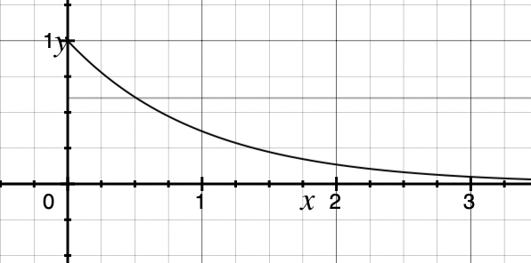

# シンギュラリティ・ソサエティ 行動と思考のカルチャーガイド

## まず大切にしてほしいこと

### AIじゃない理由

AI がこれだけのことをやってくれる時代に、**人間に残された役割は何か？** **指示を待って動く人間なら、もう AI で十分です。** 人間なら、自発的に課題を見つけて動くべきです。**雑務を振られて仕事があった時代は、もう終わりました。仕事を自ら作り出す人にしか、仕事はありません。** いま人間に問われているのは「起業家マインド」です。これは「起業しなければならない」という意味ではありません。所属する組織の中であれ、個人プロジェクトであれ、社内ツール作りであれ、自分で課題を見つけ、自分で仕事を作り出す姿勢そのものを指します。

### コーチャブル

コーチ可能かどうか。素直に意見を聞き入れて実行する状態かどうか。もし、そうでないなら双方時間の無駄。コーチャブルでない人には、何を言っても無駄で、本人の意識次第。コーチャブルな人を探すべきで、他人を変えようとしても無理。

### 本気

サッカー選手になりたいのに、ボールを蹴ったことがない人はいない。でも、プログラミングとか起業だとそういう人が多い。本気だったらすでに実践して具体的な質問をする。何を質問するかで本気度がわかる。

### ドッグフーディング

毎日使うものを自分で作って使う。

### 完璧を求めない

10％できたらすぐ出して使ってもらう。完璧になるまでリリースしないとなると、いつまでも世にでません。サグラダ・ファミリアは、いまだ建設中です。すぐに共有してフィードバックをもらえば、その時点で協力者やアイデアがでてくるかもしれません。

### 意見を聞くとき

使ってもらって、意見をくださいといえば、偉い人ほどもっともらしいことを言う。でもその意見はほとんど意味がない。お金を払ってくれる人、本気で利用する人以外の意見は無駄（意見だけ聞くと答えるが、その機能にいくら払う？ときく）。

### 〇〇の機能があったら使う、という人は無視

今あるプロダクトに機能がないから使わないという人の話は聞かない。その機能を追加して使ってくれるケースはほぼゼロ。本当にそのプロダクトに価値を感じているなら、その機能がなくても使う。

### 議論のための議論はしない

誰でも議論できて、答えのないテーマは議論をよびます。でも、その結果、なにかがうまれますか？

## 行動原則・マインドセット

- 行動する、それがすべて。
- 行動することに許可を取るな！まずは行動して、結果を報告しろ。
- deploy or die。社会に実装していくことがすべて。
- 出さない神レポートより、出すゴミレポート。
- 自分より優秀な人を仲間に入れよ。
- 絶えず締め切りを設定し、それを意識すること。締切を設定していないタスクは、やらなくてもよいタスク。
- 失敗をしていない＝挑戦をしていない。
- 極力、ものは作らないようにする。（あるものを使う、作らずに解決する方法を考える。SI思考、受託思考では無駄なものばかり作ってしまう。）
- やらない言い訳をする人には、何を言っても無駄。
- 持ち込んだアイデアに固執しない。「解決したい課題は何か」を問い、必要ならピボットする。方向性が変わっても交流は続けよう。

## 時間と優先順位に関する価値観

- 時間だけはすべての人に平等に与えられたもの。自分の時間も、他人の時間も大切に。
- タスクが多い場合、重要なのは上位２割だけ。それ以外は、やらなかったとしても、数ヶ月したら忘れるような課題。
- すべては優先度の問題。あなたがそれをしない理由は、優先度が低いと考えているから。時間がないと言って断るのは、それに興味がないと言っているのと同じ。どうしてもやりたいことなら、絶対に時間を作るはず。

## やる気と継続

- やる気は、何もしなければ時間とともに**指数関数的に減衰する**（下図）。だから、思いついた瞬間に手を動かし、アウトプットを出すことが大事。
- 継続は気合いではなく**仕組み**で支える。ほどよい課題設定、進捗が見えるようにする、気分転換、チーム化してフィードバックをもらう。
- アウトプットは小さな進捗でよい。手が止まった週は、止まった理由を書けば十分。完璧でなくていい。続けることが一番の力。

## 挑戦と失敗に対する姿勢

- 失敗は再現する。成功は再現しない。失敗は共有しよう。
- チャレンジして失敗した人を褒め称えよう。
- 新しいアイデアを説明して、みんなが「素晴らしい」というアイデアはダメ。もう遅い。２割の人が超絶に賛成し、その他の人がネガティブな意見を言うくらいのアイデアがちょうどよい。

## 倫理観・行動の透明性

- 新聞の一面に出たり、家族や子供に聞かれても恥ずかしくない行動を心がける。
- いかなる発言も、「家の玄関に貼っても問題ないか？」を基準にする。
- 未来から俯瞰して物事を考える。

## 貢献とコミュニケーション

- 与えられることより、与えることを先に考えられる人。
- 自分が組織にどんなバリューを与えられるか、自分のポジショニングを理解し、貢献できるかを考えられる人。
- 他人の期待をいつも超えてくる、越えようとしてくる意識を持つこと（100％の結果を返せるようになるのが出発点。常に120〜300％を目指そう！）
- 無料であることは、粗末にしてよいということではない。むしろお金を払っていないからこそ、より重要。
- どんなスキルよりも、人として「良いやつ」であることが重要。
- なんかわからないけど一緒に働きたいと思えるやつ。
- オンライン・非同期（テキスト）のコミュニケーションに慣れること自体が目的の一つ。能動的に発信し、結果だけでなく思考や試行の途中も書き出す。結果だけだと、軌道修正やサポートがしづらい。
- 他の人のアウトプットにも必ず目を通し、反応する。コメントできるものにはコメントし、気になる相手にはこちらから声をかける。相互に交流すること自体に価値がある。

## 能力と強みの活かし方

- 能力はデコボコでよい。全体の能力が平均以上でフラットなことよりも、ひとつだけでも飛び抜けた能力があることが重要。
- 苦手は誰かに頼って、得意を伸ばそう。

## シンギュラリティ・ソサエティ 行動指針

### アイデアを共有して行動しよう

- 何かを考えているだけでは、それは存在しないのと同じです
- なにかアイデアがあれば、それが例えくだらなくても、突拍子もなくてもアウトプットしましょう。誰かにひっかかるかもしれませんし、それが引き金となって別のアイデアがでるかもしれません。議論の出発点になります
- ダメそうに見えるアイデアでも数年後に輝くかもしれません
- 多くのアイデアは既出で、検証済みです。他人に共有することによりそのことも確認できます
- 他人のアイデアを否定することはやめましょう。どんなアイデアでもその中にある良い点を見つけるようにしましょう
- 出したアイデアは良ければ、実現に向けて動きましょう

### 議論よりプロトタイプ

- アイデアがでたら、議論を重ねる前に、まずは簡単なプロトタイプを作りましょう
- プロトタイプはプログラム/ソフトウエアでなくても、他人が検証できるものなら何でも良いです。ダンボールでも、手書きでも、そのアイデアを検証できることが重要です
- プロトタイプは本質的な機能のみに絞りましょう。単機能で検証できれば十分です

### 適材適所のテクノロジー

- エンジニアは、目的と手段を間違えがちです。アイデアの検証は、なるべく簡単な方法で行いましょう
- 最先端の技術を試したいのであれば、それを目的として検証しましょう

---

## 合わせて読む

- [行動規範](./code-of-conduct.md)
