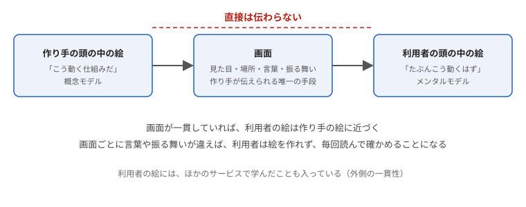
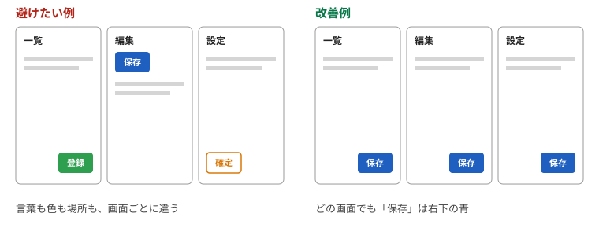

# 第1章　一貫性 — 同じものは同じ見た目・同じ場所・同じ言葉

> 連載の入口 → [UI設計の基礎](README.md)

## ひとことで

同じ意味のものは、画面のどこでも同じ見た目・同じ場所・同じ言葉にします。違う意味のものは、違って見えるようにします。

## なぜ

人は画面を一つずつ読んで理解しているのではなく、「前に見たあれと同じだろう」と推測しながら使っています。一貫性はその推測の土台です。ソシオメディアのガイドラインは、一貫性を次のように説明しています。

> 配色、形状、配置、振る舞い、などに一貫したルールを適用する。
> 一貫性はそのデザインにおける論理の体現であり、ユーザーがシステムの使い方を推測したり学習したりするための基本的な手がかりとなる。
>
> — ソシオメディア「[一貫性](https://www.sociomedia.co.jp/9055)」

NN/g の「ユーザビリティの10原則」でも、4番目が「一貫性と標準（Consistency and Standards）」です。要点は「同じことを指すのに別の言葉や操作が使われていないか、利用者に迷わせない」こと（[Ten Usability Heuristics](https://www.nngroup.com/articles/ten-usability-heuristics/)）。

## そろえるものは四つ

| そろえるもの | 例 |
| --- | --- |
| **見た目**（配色・形状・大きさ） | 「押せるもの」は全部同じ形の青いボタン。リンクは全部下線 |
| **場所**（配置） | 保存ボタンはどの画面でも右下。戻るは左上 |
| **言葉** | 同じ操作には同じ動詞。「保存」「登録」「確定」を画面ごとに変えない |
| **振る舞い** | 同じ操作は同じ結果。ある画面では自動保存、別の画面では保存ボタン、を混ぜない |

## 内側の一貫性と、外側の一貫性

一貫性には二つの向きがあります。

- **内側** … 自分のアプリの中でそろっているか
- **外側** … 世の中の慣習とそろっているか。虫眼鏡は検索、× は閉じる、下線は リンク

外側の一貫性が効く理由を、NN/g は「ヤコブの法則」と呼んでいます。利用者はほとんどの時間を他のサイトで過ごしているので、他のサイトと同じ動き方を期待する、という観察です（[Jakob's Law of Internet User Experience](https://www.nngroup.com/videos/jakobs-law-internet-ux/)）。独自の見せ方を考える前に、まず慣習に合わせるほうが安全です。

慣習の手がかりは、公開されている設計指針（デザインシステム）にあります。iPhone や Mac なら Apple の [Human Interface Guidelines](https://developer.apple.com/jp/design/human-interface-guidelines/)、Android や Web なら Google の [Material Design](https://m3.material.io/)、行政サービスなら[デジタル庁デザインシステム](https://design.digital.go.jp/)です。

## 一貫性はメンタルモデルを作る

利用者は、画面を使いながら「たぶんこう動く」という絵を頭の中に作ります。これをメンタルモデルと呼びます。NN/g の「[Mental Models and User Experience Design](https://www.nngroup.com/articles/mental-models/)」は、メンタルモデルとは利用者がそのシステムについて信じていることであり、利用者はそれをもとに次の動きを予測する、と説明しています。

作り手にも絵があります。「この仕組みはこう動く」という設計の絵で、ノーマンはこれを概念モデルと呼びます。ただし作り手は、その絵を利用者に直接は渡せません。渡せるのは画面だけです。利用者は、見た目・場所・言葉・振る舞いから、絵を自分で組み立てます。

ここで一貫性が効きます。同じ意味のものが同じ見た目・場所・言葉で出てくれば、利用者は一度学んだことを次の画面にも当てはめられます。画面ごとに違えば、絵は作れず、毎回読んで確かめることになります。ソシオメディアの「[一貫性](https://www.sociomedia.co.jp/9055)」が、一貫性を「ユーザーがシステムの使い方を推測したり学習したりするための基本的な手がかり」と呼ぶのは、このためです。同じ指針の「[メンタルモデル](https://www.sociomedia.co.jp/9012)」は、学習できる慣用表現（イディオム）によって利用者に利用モデルを与えよ、と言います。

利用者の絵には、ほかのサービスで学んだことも入っています。前の節で見た外側の一貫性は、その絵を壊さないための作法です。絵と画面がずれたときに何が起きるかは、[第8章](08-wayfinding.md)の「利用者の頭の中の絵に合わせる」で扱います。

## 避けたい例と改善例

| 避けたい例 | 改善例 | 反している一貫性 |
| --- | --- | --- |
| 一覧画面では「登録」、編集画面では「保存」、設定画面では「確定」 | すべて「保存」 | 言葉 |
| 主ボタンが青だったり緑だったりする | 主ボタンは一色。副ボタンは枠だけ、と決める | 見た目 |
| 削除ボタンが画面によって右端だったり左端だったりする | 危険な操作は毎回同じ場所に置く | 場所 |
| 一部の入力欄だけ、入力した瞬間に保存される | 自動保存か保存ボタンか、サービスの中で一つに決める（[第9章](09-no-extra-work.md)） | 振る舞い |
| 自分のアプリだけ × が「戻る」の意味 | × は閉じる。戻るは「←」か「戻る」 | 外側 |

## やってみる

自分のアプリ（または AI に作らせた画面）で、「保存する操作」をすべて書き出してください。言葉と場所が何種類あるかを数えると、一貫性のほころびが見えます。種類が一つなら合格です。

## 出典

- ソシオメディア「[一貫性](https://www.sociomedia.co.jp/9055)」
- NN/g「[10 Usability Heuristics for User Interface Design](https://www.nngroup.com/articles/ten-usability-heuristics/)」（4. Consistency and Standards）
- NN/g「[Jakob's Law of Internet User Experience](https://www.nngroup.com/videos/jakobs-law-internet-ux/)」
- Apple「[Human Interface Guidelines](https://developer.apple.com/jp/design/human-interface-guidelines/)」、Google「[Material Design 3](https://m3.material.io/)」、[デジタル庁デザインシステム](https://design.digital.go.jp/)

---

次の章 → [読まなくても分かる](02-self-evident.md)
- NN/g「[Mental Models and User Experience Design](https://www.nngroup.com/articles/mental-models/)」 — メンタルモデルは利用者がシステムについて信じていること
- ソシオメディア「[メンタルモデル](https://www.sociomedia.co.jp/9012)」 — 学習できる慣用表現で利用モデルを与える
- D. A. ノーマン『[誰のためのデザイン？ 増補・改訂版](https://www.shin-yo-sha.co.jp/book/b455574.html)』新曜社、2015年 — 概念モデルと、画面を通してしか伝わらないという考え方
