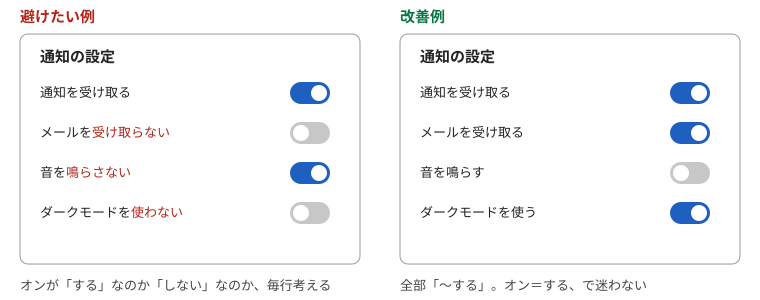
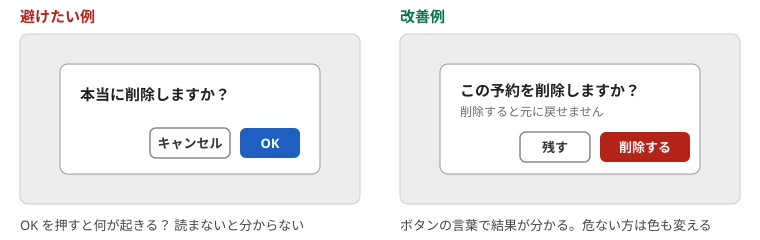

# 第3章　言葉とスイッチ — 肯定形にそろえる、ラベルは短く、ボタンは動詞

> 連載の入口 → [UI設計の基礎](README.md)

## ひとことで

画面の言葉は、短く、肯定形で、利用者がふだん使う言葉にします。スイッチは「切り替えた瞬間に効く二択」にだけ使い、ボタンの言葉は「押すと何が起きるか」が分かる動詞にします。

## 利用者の言葉を使う

> インターフェース上で使う文言は、システム内部の技術用語や運営者の業界用語ではなく、ユーザーが普段使っている一般的な表現を用いる。
>
> — ソシオメディア「[ユーザーの言葉を使う](https://www.sociomedia.co.jp/9108)」

同じページの例は航空券の予約です。出発地の選択肢に「NRT」「HND」のような空港コードではなく、「成田空港」「羽田空港」のような空港名を出す、というものです。NN/g の10原則では2番目「システムと現実世界の一致（Match Between the System and the Real World）」にあたります。

| 避けたい例 | 改善例 |
| --- | --- |
| 「ステータス: pending」 | 「状態: 確認待ち」 |
| 「セッションが無効です」 | 「しばらく操作がなかったので、もう一度ログインしてください」 |
| 「レコードを削除しますか」 | 「この予約を削除しますか」 |

## 肯定形と否定形をまぜない

設定の項目は「〜する」の形にそろえます。否定形が混ざると、利用者は項目ごとに「オンは、する？ しない？」を考え直すことになります。

| 避けたい例 | 改善例 |
| --- | --- |
| 「通知を受け取る」と「メールを受け取らない」が並ぶ | 「通知を受け取る」「メールを受け取る」にそろえる |
| 「自動保存を無効にする」がオフ | 「自動保存する」がオン |
| 「広告を表示しない」をオンにすると広告が消える | 「広告を表示する」をオフにする |
| 「確認を省略しない」 | 「削除の前に確認する」 |

NN/g のトグルスイッチの指針も、ラベルは「短く、直接的に」、どちらの状態かが一目で分かるように、としています（[Toggle-Switch Guidelines](https://www.nngroup.com/articles/toggle-switch-guidelines/)）。二重否定（「無効にしない」）は、その場で読み解けません。

## スイッチ・チェックボックス・ラジオボタンの使い分け

形が似ていても役割が違います。間違えると、利用者は「保存ボタンを押したのに効いていない」「押した覚えがないのに変わっている」と混乱します。

| 部品 | 使う場面 | 使わない場面 |
| --- | --- | --- |
| **スイッチ** | 切り替えた瞬間に効く二択。通知のオン・オフ、表示の切り替え | 保存や送信を押して初めて効くもの |
| **チェックボックス** | 複数の項目から好きな数だけ選ぶ。フォームの中で保存と一緒に効く | 一つしか選べない質問 |
| **ラジオボタン** | 複数の選択肢から一つだけ選ぶ | 選択肢が多すぎるとき（一覧から選ぶ部品にする） |

デジタル庁デザインシステムは、スイッチを「切り替えたら即座に反映される設定項目のためのコントロール」とし、「保存ボタンや送信ボタンなどの確定動作を要するもの」にはチェックボックスやラジオボタンを使うとしています（[スイッチ](https://design.digital.go.jp/components/switch/)）。チェックボックスのページには、一つしか選べない質問（「あなたは申請者本人ですか？」）にチェックボックスを使った悪い例が載っていて、「この場合は、ラジオボタンを使用してください」と書かれています（[チェックボックス: 使い方](https://design.digital.go.jp/components/checkbox/usage/)）。NN/g のトグルの指針も同じで、スイッチは即時に効く二択に限り、フォームの送信が要るならチェックボックスかラジオボタンに、です。

## ボタンの言葉は動詞で、結果が分かるように

「OK」「はい」「いいえ」は、何が起きるかを言っていません。NN/g は確認ダイアログについて、はい・いいえではなく、それぞれの選択で何が起きるかを要約した言葉にせよ、と書いています。

> Instead of Yes/No answers, provide response options that summarize what will happen for each possible response. For example, in the case of file deletion, use buttons labeled Delete file and Keep file.
>
> — NN/g「[Confirmation Dialogs Can Prevent User Errors — If Not Overused](https://www.nngroup.com/articles/confirmation-dialog/)」

| 避けたい例 | 改善例 |
| --- | --- |
| 「本当に削除しますか？」［OK］［キャンセル］ | 「この予約を削除しますか？」［削除する］［残す］ |
| ［送信］（何を送るのか分からない） | ［申込を送信する］ |
| ［はい］［いいえ］ | ［保存して閉じる］［保存せずに閉じる］ |

## 入力欄のラベルと入力例

入力欄の名前（ラベル）は、欄の上に置き、入力例（プレースホルダー。欄の中に薄く出る文字）で代用しません。入力例は書き始めた瞬間に消えるので、何の欄だったか分からなくなります。デジタル庁デザインシステムは「サポートテキストを企図して、プレースホルダーテキストを使用してはなりません」としています（[テキスト入力: 使い方](https://design.digital.go.jp/components/input-text/usage/)）。必須か任意かは、欄の名前の横に「※必須」「※任意」のように明示します。

## やってみる

設定画面の項目名を全部書き出し、「〜する」で終わっていないものに印を付けてください。印が付いた項目を肯定形に書き直し、オンとオフの意味が入れ替わっていないか確かめます。

## 出典

- ソシオメディア「[ユーザーの言葉を使う](https://www.sociomedia.co.jp/9108)」
- NN/g「[Toggle-Switch Guidelines](https://www.nngroup.com/articles/toggle-switch-guidelines/)」「[Confirmation Dialogs Can Prevent User Errors — If Not Overused](https://www.nngroup.com/articles/confirmation-dialog/)」「[10 Usability Heuristics](https://www.nngroup.com/articles/ten-usability-heuristics/)」（2. Match Between the System and the Real World）
- デジタル庁デザインシステム「[スイッチ](https://design.digital.go.jp/components/switch/)」「[チェックボックス: 使い方](https://design.digital.go.jp/components/checkbox/usage/)」「[テキスト入力: 使い方](https://design.digital.go.jp/components/input-text/usage/)」

---

次の章 → [状態を伝える・間違いを防ぐ](04-feedback-errors.md)
