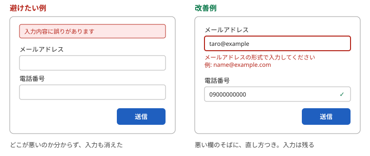
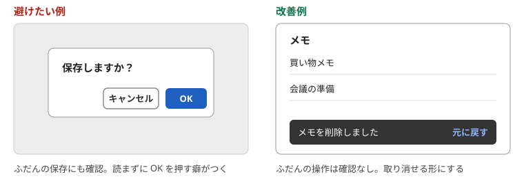

# 第4章　状態を伝える・間違いを防ぐ — フィードバック、取り消し、エラー文、確認

> 連載の入口 → [UI設計の基礎](README.md)

## ひとことで

いま何が起きているかを常に見せ、間違えにくい形にし、間違えても戻れるようにします。エラー文は起きた場所のそばに、直し方つきで出します。

## 状態を伝える（フィードバック）

NN/g の10原則の1番目は「システム状態の可視化（Visibility of System Status）」です。押したら押したと分かる、保存したら保存したと分かる、待たせるなら待っていると分かる、が基本です。ノーマンも『誰のためのデザイン？』で、操作の結果がすぐ返ってくること（フィードバック）を良いデザインの条件に挙げています。

| 避けたい例 | 改善例 |
| --- | --- |
| 保存ボタンを押しても画面が変わらない | 「保存しました」と短く出す。ボタンを一瞬「保存中…」にする |
| 読み込みに5秒かかるが、何も表示されない | 読み込み中の表示を出す。長いなら進み具合も |
| 送信に失敗したのに、成功したときと同じ画面に戻る | 失敗したこと、原因、次にすることを出す |

## 取り消せるようにする（主導権）

10原則の3番目は「ユーザーの制御と自由（User Control and Freedom）」です。間違えて押した操作から、長い手順なしに抜け出せること。ソシオメディアのガイドラインの「[ユーザーの主導権](https://www.sociomedia.co.jp/9058)」も同じ趣旨です。

いちばん強い形は「元に戻す」です。確認ダイアログを毎回出すより、実行したあとに「元に戻す」を数秒出すほうが、利用者の手を止めません（メールの送信取り消しがこの形です）。

## 間違いを防ぐ（制約）

10原則の5番目は「エラーの予防（Error Prevention）」です。間違えてから直させるより、間違えられない形にします。ソシオメディアの「[エラーを回避する](https://www.sociomedia.co.jp/9138)」と、ノーマンの言う**制約**（できないことを、できないように見せる）が土台です。

| 避けたい例 | 改善例 |
| --- | --- |
| 日付を自由入力させて、形式が違うとエラー | カレンダーから選ばせる |
| 在庫がない商品もカートに入れられ、あとでエラー | 在庫がない商品は「入荷待ち」にして押せなくする |
| 郵便番号を入れても住所が出ない | 郵便番号から住所を自動で埋める |
| 押せないボタンが、押せるボタンと同じ見た目 | 押せない理由を近くに書く。理由がないなら消す |

## エラー文は、そばに、平易に、直し方つきで

エラーが出るときの書き方は、NN/g がガイドラインにまとめています（[Error-Message Guidelines](https://www.nngroup.com/articles/error-message-guidelines/)）。要点は三つです。

1. **見える** … 起きた場所のすぐそばに、目立つ色で。画面の一番上にまとめて出すと、どの欄か分からなくなる（[第2章](02-self-evident.md)「記憶に頼らない」）
2. **伝わる** … 利用者の言葉で、何が問題かを簡潔に、どう直せばよいかを添えて。利用者を責めない
3. **手間を減らす** … 入力した内容は消さない。よくある間違いは最初から防ぐ

| 避けたい例 | 改善例 |
| --- | --- |
| 「エラーが発生しました」 | 「メールアドレスの形式が違います。例: name@example.com」 |
| 「不正な入力です」 | 「電話番号は数字だけで入力してください（ハイフンなし）」 |
| 送信に失敗すると、入力が全部消える | 入力は残したまま、失敗した欄だけ示す |
| 画面上部に「3件のエラーがあります」だけ | 各欄のそばに赤い文で、何をどう直すか |

## 確認は「重大なときだけ」

確認ダイアログは、出しすぎると読まれなくなります。NN/g は、作業を失う・大きな金額がかかるなど重大な結果を伴う操作の前にだけ使い、日常の操作には使わない、としています。

> Use a confirmation dialog before committing to actions with serious consequences — such as destroying users' work or costing large amounts of money.
> Do not use confirmation dialogs for routine actions.
>
> — NN/g「[Confirmation Dialogs Can Prevent User Errors — If Not Overused](https://www.nngroup.com/articles/confirmation-dialog/)」

出すときのボタンの言葉は、[第3章](03-labels-switches.md)のとおり「削除する」「残す」のように結果が分かる動詞にします。

## やってみる

自分のアプリで「押しても何も起きないように見える操作」を探してください。保存・送信・切り替えのそれぞれで、押した直後に画面のどこが変わるかを書き出します。変わらないものがフィードバック不足です。

## 出典

- NN/g「[10 Usability Heuristics](https://www.nngroup.com/articles/ten-usability-heuristics/)」（1. Visibility of System Status、3. User Control and Freedom、5. Error Prevention、9. Help Users Recognize, Diagnose, and Recover from Errors）
- NN/g「[Error-Message Guidelines](https://www.nngroup.com/articles/error-message-guidelines/)」「[Confirmation Dialogs Can Prevent User Errors — If Not Overused](https://www.nngroup.com/articles/confirmation-dialog/)」
- ソシオメディア「[ユーザーの主導権](https://www.sociomedia.co.jp/9058)」「[エラーを回避する](https://www.sociomedia.co.jp/9138)」
- D. A. ノーマン『[誰のためのデザイン？ 増補・改訂版](https://www.shin-yo-sha.co.jp/book/b455574.html)』（新曜社）

---

次の章 → [配置と量](05-layout.md)
