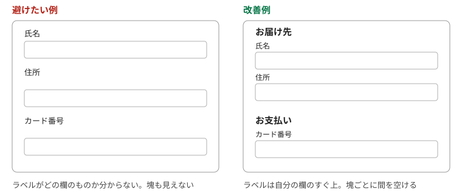
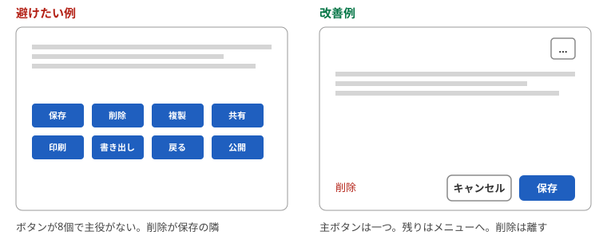

# 第5章　配置と量 — 近いものはまとまって見える、大きく近いものは押しやすい、選択肢は減らす

> 連載の入口 → [UI設計の基礎](README.md)

## ひとことで

関係のあるものを近くに、関係のないものを離して置きます。よく押すものは大きく近くに、危ないものは離して。選択肢は減らし、一画面の主役は一つにします。

## 近いものは仲間に見える（ゲシュタルト）

人の目は、近くにあるものを一つのまとまりとして見ます。線や枠で囲まなくても、距離だけでグループが伝わります。ソシオメディアの「[視覚ゲシュタルト](https://www.sociomedia.co.jp/9099)」、NN/g の「[近接の法則](https://www.nngroup.com/articles/gestalt-proximity/)」が出典です。

| 避けたい例 | 改善例 |
| --- | --- |
| ラベルが上下の入力欄のちょうど中間にあり、どちらの名前か分からない | ラベルは自分の欄に近づけ、隣の欄とは離す |
| 「氏名」「住所」「カード番号」が等間隔に並ぶ | 「お届け先」と「お支払い」で間隔を空けて二つの塊にする |
| 関係ない注意書きがボタンのすぐ横にある | 注意書きは関係する欄のそばに移す |

## 大きく近いものは押しやすい（フィッツの法則）

目標が大きいほど、近いほど、速く正確に押せます。ソシオメディアの「[フィッツの法則](https://www.sociomedia.co.jp/9146)」と NN/g の「[Fitts's Law and Its Applications in UX](https://www.nngroup.com/articles/fitts-law/)」が出典です。

| 避けたい例 | 改善例 |
| --- | --- |
| スマホで、文字と同じ大きさのリンクが並ぶ | 指で押せる大きさにし、間を空ける |
| 主ボタンが画面の端に小さく置かれている | 主ボタンは大きく、操作の流れの先に置く |
| 「保存」と「削除」が同じ大きさで隣り合う | 削除は離し、見た目も変える（枠だけ、赤） |

## 選択肢が多いほど迷う（ヒックの法則）

選択肢の数が増えるほど、選ぶのに時間がかかります。ソシオメディアの「[ヒックの法則](https://www.sociomedia.co.jp/9177)」が出典です。メニューを減らす、段階に分ける、よく使うものを前に出す、が具体策です。

| 避けたい例 | 改善例 |
| --- | --- |
| 設定画面に40項目が一列に並ぶ | 「表示」「通知」「アカウント」に分ける。よく使う項目を上に |
| 都道府県を自由入力で選ばせる | 一覧から選ぶ。郵便番号から自動で埋める |
| 最初の画面にボタンが12個 | 利用者の8割がやることを1〜3個に絞り、残りはメニューへ |

## 一画面に主役は一つ

NN/g の10原則の8番目は「美的で最小限のデザイン（Aesthetic and Minimalist Design）」です。関係のない情報は、関係のある情報を見えにくくします。デジタル庁デザインシステムも、いちばん重要な操作のためのプライマリーボタンは「ひとつの画面につき、原則1つまで」としています（[ボタン: 使い方](https://design.digital.go.jp/components/button/usage/)）。

余白は「何もない無駄な場所」ではなく、まとまりと主役を伝える道具です。デジタル庁デザインシステムの「[余白](https://design.digital.go.jp/foundations/spacing/)」に、余白の取り方の考え方があります。

## やってみる

自分の画面を、ぼかして（目を細めて）見てください。いくつの塊に見えるか、どこがいちばん目立つかを数えます。塊が多すぎる、主役が二つ以上ある、なら配置を見直します。

## 出典

- ソシオメディア「[視覚ゲシュタルト](https://www.sociomedia.co.jp/9099)」「[フィッツの法則](https://www.sociomedia.co.jp/9146)」「[ヒックの法則](https://www.sociomedia.co.jp/9177)」
- NN/g「[The Principle of Proximity in Gestalt Psychology](https://www.nngroup.com/articles/gestalt-proximity/)」「[Fitts's Law and Its Applications in UX](https://www.nngroup.com/articles/fitts-law/)」「[10 Usability Heuristics](https://www.nngroup.com/articles/ten-usability-heuristics/)」（8. Aesthetic and Minimalist Design）
- デジタル庁デザインシステム「[ボタン: 使い方](https://design.digital.go.jp/components/button/usage/)」「[余白](https://design.digital.go.jp/foundations/spacing/)」

---

次の章 → [誰でも使える](06-accessibility.md)
