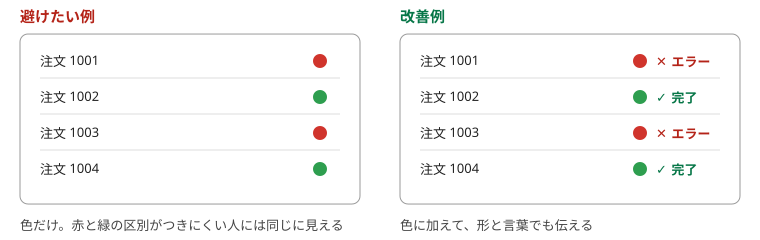
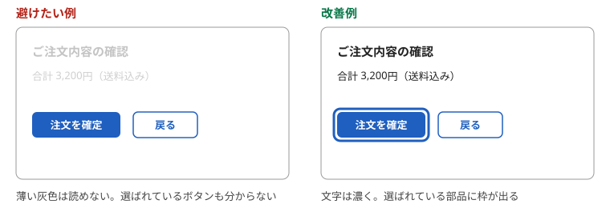

# 第6章　誰でも使える — 色だけで区別しない、コントラスト、文字サイズ、キーボード

> 連載の入口 → [UI設計の基礎](README.md)

## ひとことで

目や手や環境の条件が違っても使える画面にします。次の五つで大半をカバーできます。

- 色だけに頼らない
- 文字と背景の差をつける
- 文字を大きくしても崩れない
- マウスなしでも操作できる
- 画像とアイコンには言葉を付ける

## なぜ

「誰でも使える」は、障害のある人のためだけの話ではありません。日差しの下でスマホを見る人、片手がふさがっている人、老眼の人、色の見え方が違う人、キーボードだけで操作したい人。条件が悪いときに使えるかどうかは、全員に効きます。

基準として世界で使われているのが W3C の WCAG（ウェブコンテンツ・アクセシビリティ・ガイドライン）で、日本語訳は WAIC（ウェブアクセシビリティ基盤委員会）が公開しています（[WCAG 2.1（日本語訳）](https://waic.jp/translations/WCAG21/)）。日本の規格 JIS X 8341-3はこれに対応しています。デジタル庁デザインシステムの部品は、この達成基準を満たすように作られています（[ウェブアクセシビリティ](https://design.digital.go.jp/webaccessibility/)）。

## 五つの基本

### 1. 色だけで区別しない

赤と緑だけで「エラー」と「正常」を分けると、色の見え方が違う人には同じに見えます。色に加えて、言葉・形・アイコンを付けます（WCAG 1.4.1「色の使用」）。

| 避けたい例 | 改善例 |
| --- | --- |
| 必須項目の名前を赤くするだけ | 「※必須」と書く |
| グラフの線を色だけで区別 | 線の種類（実線・点線）と凡例の言葉も変える |
| エラーの欄を赤枠にするだけ | 赤枠に加えて、欄のそばにエラー文 |

### 2. 文字と背景の差（コントラスト）をつける

薄いグレーの文字は、きれいに見えても読めません。WCAG は通常の文字でコントラスト比4.5対1以上、大きな文字で3対1以上を求めています（WCAG 1.4.3、コントラスト・最低限）。デジタル庁デザインシステムの「[カラー](https://design.digital.go.jp/foundations/color/)」は、この基準を満たす色の組み合わせを前提に作られています。

### 3. 文字を大きくしても崩れない

利用者がブラウザの文字サイズを大きくしても、はみ出したり重なったりしないようにします（WCAG 1.4.4「テキストのサイズ変更」）。文字の大きさや行間の考え方は、デジタル庁デザインシステムの「[タイポグラフィ](https://design.digital.go.jp/foundations/typography/)」にあります。

### 4. キーボードだけで操作できる

マウスやタッチが使えない人は、Tab キーで部品を順に移動し、Enter や Space で押します。すべての操作がキーボードだけでできること（WCAG 2.1.1「キーボード」）、いまどこにいるかが見えること（WCAG 2.4.7「フォーカスの可視化」）が条件です。

| 避けたい例 | 改善例 |
| --- | --- |
| マウスを載せたときだけ出るメニュー | キーボードでも開ける。開いたら中の項目に移動できる |
| フォーカスの枠を「見た目が悪いから」消す | 枠は残す。色や太さを整える |
| 文字の見た目だけボタンにした要素 | ボタンの部品を使う（部品ならキーボード操作は最初から効く） |

### 5. 画像とアイコンに言葉を付ける

画面を読み上げる道具（スクリーンリーダー）は、画像やアイコンを見られません。代わりになる言葉（代替テキスト）が要ります（WCAG 1.1.1「非テキストコンテンツ」）。デジタル庁デザインシステムは、テキストのラベルを持たないボタンには「必ず代替テキストを指定」としています（[ボタン: アクセシビリティ](https://design.digital.go.jp/components/button/accessibility/)）。これは[第2章](02-self-evident.md)の「アイコンには言葉を添える」と同じ話です。

## やってみる

自分のアプリを、マウスを使わずに Tab キーだけで最初から最後まで操作してみてください。途中で先に進めなくなった場所、いまどこにいるか分からなくなった場所が、直すところです。

## 出典

- WAIC「[WCAG 2.1（日本語訳）](https://waic.jp/translations/WCAG21/)」（1.1.1、1.4.1、1.4.3、1.4.4、2.1.1、2.4.7）
- デジタル庁デザインシステム「[ウェブアクセシビリティ](https://design.digital.go.jp/webaccessibility/)」「[カラー](https://design.digital.go.jp/foundations/color/)」「[タイポグラフィ](https://design.digital.go.jp/foundations/typography/)」「[ボタン: アクセシビリティ](https://design.digital.go.jp/components/button/accessibility/)」

---

次の章 → [AI に画面を作らせるときの見方](07-ai-review.md)
