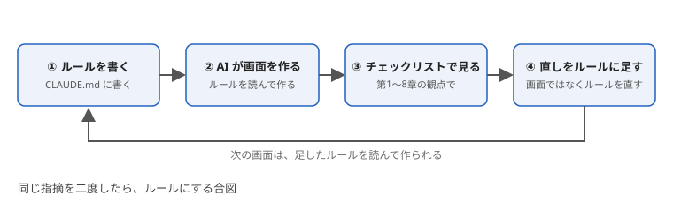

# 第7章　AI に画面を作らせるときの見方 — 指示文とレビュー観点、チェックリスト

> 連載の入口 → [UI設計の基礎](README.md)

## ひとことで

第1章から第6章と第8章・第9章の原則を、AI への指示文と、できた画面を見るときの観点に変えます。守らせたい原則は、毎回のお願いではなく、毎回自動で効く場所（CLAUDE.md や lint）に書きます。

## AI が崩しやすいのは一貫性

AI に画面を一つずつ頼むと、画面ごとに言葉・色・配置が少しずつ変わります。一画面だけ見れば正しいのに、並べると[第1章](01-consistency.md)の一貫性が崩れている、という形です。対策は二つです。

1. **部品を共通にする** … ボタン・入力欄・見出しを一か所で定義し、全画面でそれを使うよう指示する。考え方は[リファクタリング & プロダクト化](../refactoring.md)の「同じものを二度書かない」と同じです
2. **言葉の一覧を渡す** … 「保存」「削除」「戻る」など、使う動詞の一覧を最初に決めて渡す

## 指示文に書くこと

「口頭の注意」は次の会話で忘れられます。[AIハーネス入門](../harness/README.md)の考え方どおり、プロジェクトの CLAUDE.md（AI が毎回読む指示書）に書いておきます。例です。

```markdown
## 画面のルール

- ボタンの言葉は動詞で、押した結果が分かるようにする（「OK」「はい」は使わない）
- 設定の項目名は肯定形「〜する」にそろえる。否定形と二重否定は使わない
- アイコンには必ず言葉を添える。アイコンだけのボタンには代替テキストを付ける
- エラー文は、その入力欄のすぐそばに、直し方つきで出す
- 確認ダイアログは、取り消せない操作にだけ出す
- 色だけで状態を区別しない。文字と背景のコントラスト比は 4.5 対 1 以上
- ボタン・入力欄・見出しは共通部品を使う。画面ごとに新しく作らない
- 一画面の主ボタンは一つ。保存は自動保存か保存ボタンかを一つに決め、保存ボタンなら常に右下
- 手続きが複数の画面に分かれるときは、何段階あり、いま何番目かを出す
- たまにしか使わない設定は「詳細設定」に折りたたみ、よく使う項目には初期値を入れる
- システムが分かること（郵便番号からの住所、生年月日からの年齢）は入力させない。同じ情報を二度聞かない
- 入力の形式や文字種の違いで突き返さない。そろえるのはシステム側で行う
- パスワード欄には表示の切り替えを付け、貼り付けとパスワードマネージャーを禁止しない。メールアドレスを二回入れさせない
- 画面の中に「戻る」ボタンを作らない。移動のリンクが要るなら「注文一覧へ」のように行き先を書く
```

機械で判定できるものは、お願いより lint（自動検査）に任せるほうが確実です。アクセシビリティの基本（画像の代替テキスト、ラベルのない入力欄など）は、React なら [eslint-plugin-jsx-a11y](https://www.npmjs.com/package/eslint-plugin-jsx-a11y)、Vue なら [eslint-plugin-vuejs-accessibility](https://www.npmjs.com/package/eslint-plugin-vuejs-accessibility) が指摘してくれます。できた画面は、ブラウザに入っている [Lighthouse](https://developer.chrome.com/docs/lighthouse/overview?hl=ja) のアクセシビリティ診断で点数が出ます。設定のしかたは[AIハーネス入門](../harness/README.md)の lint の章を見てください。

## できた画面を見るときの観点

AI が画面を出したら、コードを読む前に画面を開いて、次の順に見ます。

1. **3秒テスト** … 説明なしで、この画面で何ができるか言えるか（[第2章](02-self-evident.md)）
2. **言葉** … ボタンは動詞か。設定は肯定形か。利用者の言葉か（[第3章](03-labels-switches.md)）
3. **一貫性** … 前に作った画面と、言葉・色・位置がそろっているか（[第1章](01-consistency.md)）
4. **操作の結果** … 押したら何か変わるか。間違えたら戻れるか。エラー文はそばに出るか（[第4章](04-feedback-errors.md)）
5. **配置** … 塊はいくつか。主役は一つか。押しやすい大きさか（[第5章](05-layout.md)）
6. **誰でも** … Tab キーだけで通せるか。色だけで区別していないか（[第6章](06-accessibility.md)）
7. **流れ** … いまどこで、次に何をするかが分かるか。初期値は入っているか（[第8章](08-wayfinding.md)）
8. **入力** … 聞かなくていいことを聞いていないか。書き方の違いで突き返していないか。書いたものが消えないか（[第9章](09-no-extra-work.md)）

直すときは、画面を直させるのではなく「ルールを CLAUDE.md に足す」ことを先にします。同じ指摘を二度しているなら、それはルールにするべき合図です。



## チェックリスト

**言葉**

- [ ] ボタンの言葉は動詞で、押した結果が分かる
- [ ] 設定の項目名は肯定形「〜する」にそろっている
- [ ] 技術用語・内部の言葉が画面に出ていない
- [ ] 入力欄のラベルが欄の上にあり、入力例で代用していない

**見た目と配置**

- [ ] 同じ操作は、全画面で同じ言葉・色・位置になっている
- [ ] 押せるものは押せそうに見え、押せないものと区別できる
- [ ] アイコンには言葉が添えてある
- [ ] 一画面の主ボタンは一つ。危険な操作は離してある
- [ ] 「戻る」ボタンがない。移動のリンクは行き先の名前になっている

**操作**

- [ ] 押した直後に、画面のどこかが変わる
- [ ] 取り消せる。取り消せない操作にだけ確認が出る
- [ ] エラー文は欄のそばに、直し方つきで出る。入力は消えない
- [ ] 手順が複数の画面に分かれるなら、いま何番目かが見える
- [ ] よく使う項目に初期値が入り、たまにしか使わない設定は折りたたまれている
- [ ] システムが分かることや、前に聞いたことを、もう一度入力させていない
- [ ] 形式や文字種の違いで突き返さず、システム側でそろえている
- [ ] 書いている途中のものが消えない（自動保存か、入力を残す）
- [ ] パスワードは表示を切り替えられ、貼り付けできる。メールアドレスは一回だけ聞く

**誰でも**

- [ ] 色だけで状態を区別していない
- [ ] Tab キーだけで最後まで操作できる
- [ ] 画像とアイコンに代替テキストがある

## 出典

この章は、第1章から第6章と第8章・第9章の出典を指示文と観点に組み替えたものです。lint と診断の道具については次を参照してください。

- [eslint-plugin-jsx-a11y](https://www.npmjs.com/package/eslint-plugin-jsx-a11y)、[eslint-plugin-vuejs-accessibility](https://www.npmjs.com/package/eslint-plugin-vuejs-accessibility)
- Chrome「[Lighthouse の概要](https://developer.chrome.com/docs/lighthouse/overview?hl=ja)」
- [AIハーネス入門](../harness/README.md)

---

付録 → [用語ミニ辞典](apx-a-glossary.md) ／ [出典と書籍](apx-b-sources.md)
