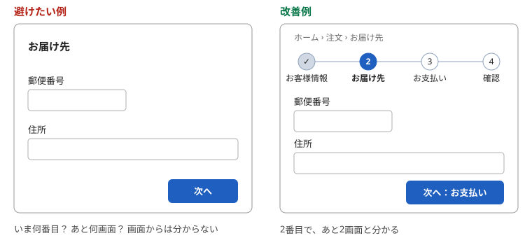
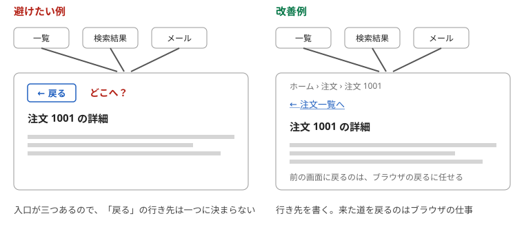
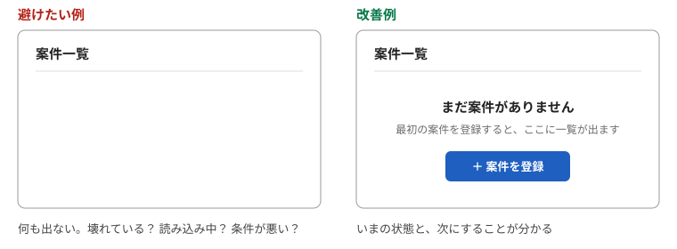
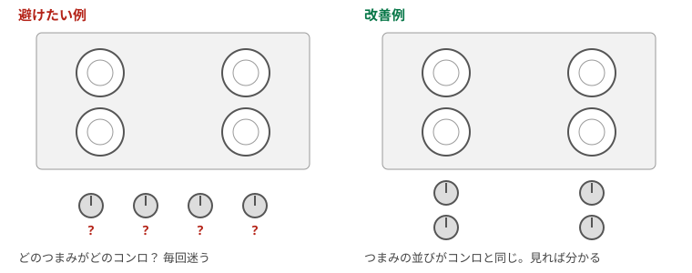
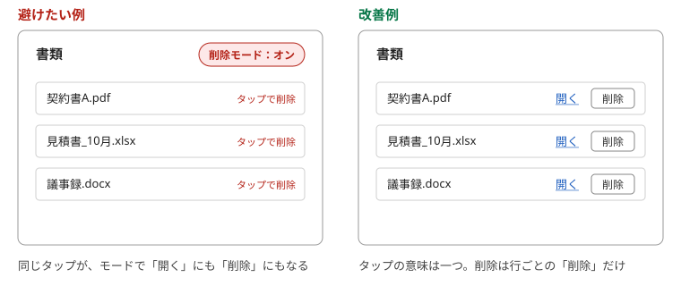
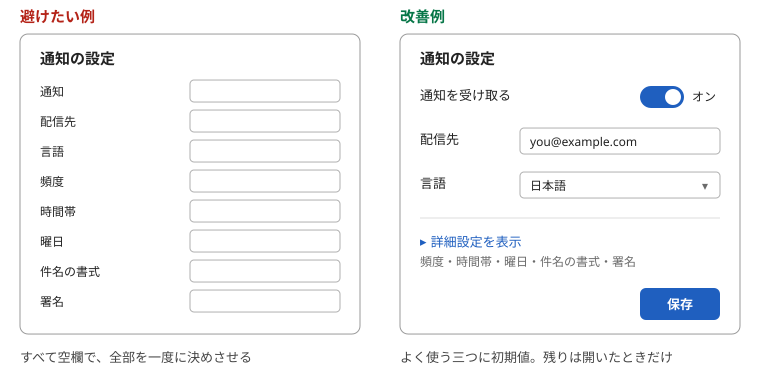
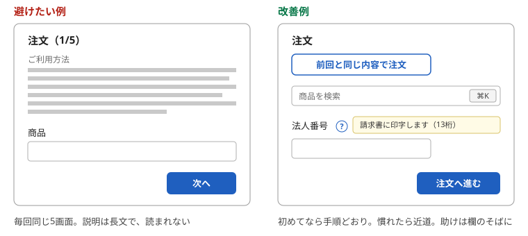

# 第7章　迷わせない — 現在地を見せる、頭の中の絵に合わせる、最初は少なく、慣れたら近道

> 連載の入口 → [UI設計の基礎](README.md)

## ひとことで

利用者が「いまどこにいて、次に何をすればよいか」を、画面から読み取れるようにします。そのために、現在地と進み具合を見せ、利用者が頭の中に持つ仕組みの絵に合わせ、最初は少なく見せて、慣れた人には近道を用意します。

## なぜ

人は、いま何が起きているか分からないと不安になります。不安になると、操作をやめるか、同じボタンを何度も押します。NN/g の「[Progress Indicators Make a Slow System Less Insufferable](https://www.nngroup.com/articles/progress-indicators/)」は、処理中の表示を出さないシステムで、押し直しによる余計なクリックや二重注文が起きてきたと書いています。

[第2章](02-self-evident.md)の「読まなくても分かる」は、一つの画面に閉じた話でした。この章は、画面と画面のあいだ、つまり流れの話です。

## 1. 現在地と進み具合を見せる

### 手順の何番目かを出す

申し込みや注文が複数の画面に分かれるなら、全体で何段階あり、いま何番目かを見せます。デジタル庁デザインシステムはこの部品を「[ステップナビゲーション](https://design.digital.go.jp/components/step-navigation/)」と呼び、完了までに必要な作業を俯瞰し、進行状況を把握できるようにするものだと説明しています。

サイトの階層が深いなら、「ホーム › 注文 › お届け先」のような現在地の表示（パンくず）を付けます。NN/g の「[Breadcrumbs: 11 Design Guidelines for Desktop and Mobile](https://www.nngroup.com/articles/breadcrumbs/)」は、検索結果から途中の階層に直接来た人の道しるべになると書いています。デジタル庁の「[パンくずナビゲーション](https://design.digital.go.jp/components/breadcrumb/usage/)」は、ページの上の方、見出しのすぐ上に置くとしています。

### 「戻る」ではなく行き先を書く

この連載では、画面の中に「戻る」ボタンを作らないことを勧めます。一つの画面に来る道は一つとは限りません。一覧から来た人、検索結果から来た人、メールのリンクから来た人がいて、「戻る」がどこへ行くのかは人によって違います。来た道を戻るのは、ブラウザや OS の「戻る」の仕事です（[第1章](01-consistency.md)の外側の一貫性）。

それでもリンクが要るなら、行き先を書きます。「注文一覧へ」「設定へ」「ホームへ」です。英国政府のデザインシステムの「[Back link](https://design-system.service.gov.uk/components/back-link/)」は、単純な手続きなら「Back」でよいが、入口が多い複雑なサービスでは「Go back to [page]」のように行き先を書くよう勧めています。「Back」では、どこへ戻るのか分からないからです。この連載が「作らない」まで言い切るのは、入口が一つに決まっている画面は少なく、あとから増えることも多いからです。最初から行き先を書いておけば、入口が増えても壊れません。戻るリンクを置くなら、利用者が最後に見た状態のその画面へ戻すこと、パンくずと併用しないことも、同じページの指針です。

### 処理中は「待っている」と見せる

押してから結果が出るまでに間があるなら、処理中であることを見せます。NN/g の「[Progress Indicators Make a Slow System Less Insufferable](https://www.nngroup.com/articles/progress-indicators/)」は、1秒を超える待ちには処理中の表示を出すよう勧めています。表示の種類は長さで使い分けます。数秒で終わるなら回転する印、10秒以上かかるなら進み具合が分かる棒にし、終わる見込みも示します。デジタル庁は、一時的な待ちには「[プログレスインジケーター](https://design.digital.go.jp/components/progress-indicator/)」、手続き全体の進み具合にはステップナビゲーション、と使い分けを定めています。

### 空の画面も「状態」のうち

一覧に何もないとき、ただ白い画面を出すと、利用者は「壊れた？」「読み込み中？」「絞り込みを間違えた？」と迷います。NN/g の「[Designing Empty States in Complex Applications: 3 Guidelines](https://www.nngroup.com/articles/empty-state-interface-design/)」は、空の画面でいまの状態と次にできることを伝えるよう勧めています。

| 避けたい例 | 改善例 |
| --- | --- |
| 4画面に分かれた申し込みで、各画面に「次へ」しかない | 上部に「1 お客様情報、2 お届け先、3 お支払い、4 確認」を出し、現在地を塗る |
| 「送信」を押しても画面が変わらず、もう一度押される | 押した直後にボタンを「送信中…」にし、回転する印を出す |
| 検索結果がないとき、何も表示されない | 「一致するものはありません。条件を減らしてみてください」と出す |
| どこから来ても同じ「戻る」ボタン | 行き先を書く。「注文一覧へ」「設定へ」。来た道を戻るのはブラウザに任せる |

## 2. 利用者の頭の中の絵に合わせる

### 概念モデル

利用者は、初めての画面でも「たぶんこう動くはず」という絵を頭の中に持っています。この絵がメンタルモデルで、作り手の側の絵が概念モデルです。定義と、一貫性がこの絵をどう作るかは、[第1章](01-consistency.md)の「一貫性はメンタルモデルを作る」にあります。ここでは、絵と画面がずれたときの話です。その絵と画面の動きが合っていれば迷いません。ずれていれば、説明を読んでも迷います。

身近な例は、スマホの写真アプリです。利用者は「アルバムは写真を入れる箱」と思っています。アルバムから写真を外したら元の写真まで消える仕組みだと、その絵とずれて事故になります。ソシオメディアの「[メンタルモデル](https://www.sociomedia.co.jp/9012)」は、利用者が想像する利用モデルに合った構成と動きにせよ、と言っています。

### 対応づけ（マッピング）

操作する場所と、結果が出る場所の対応が見て分かることを、対応づけと言います。ノーマンの有名な例がコンロです。四つのコンロが四角に並んでいるのに、つまみが一列に並んでいると、どのつまみがどのコンロか毎回迷います。つまみをコンロと同じ並びにすれば、見ただけで分かります。ソシオメディアの「[マッピング](https://www.sociomedia.co.jp/9049)」も、位置関係・形・色・記号で手がかりを与えよ、としています。

画面でも同じです。右側の一覧を並べ替えるボタンが左端の離れた場所にある、音量の調節と音量の表示が別の画面にある、といった配置は対応づけが切れています。

### モードを作らない

同じ操作の意味が、場面によって変わる状態をモードと言います。ソシオメディアの「[モードレス](https://www.sociomedia.co.jp/9094)」は、できるだけモードをなくせ、と言います。モードがあると、その場でできる操作が限られ、操作の順番も固定されます。途中で考えを変えたときには、まずモードから抜ける操作が要ります。

ボタン一つでオンとオフを切り替えるとき、ラベルがいまの状態なのか押した後の状態なのか分からなくなる問題も、モードの仲間です。ソシオメディアはこれを「[フリップフロップ問題](https://www.sociomedia.co.jp/9502)」と呼び、状態の表示とボタンの言葉を分けよ、としています。[第3章](03-labels-switches.md)のスイッチの話とつながります。

| 避けたい例 | 改善例 |
| --- | --- |
| 「削除モード」に入ると、行をタップするだけで消える | 行ごとに「削除」を置く。モードは作らない |
| 「ミュート」というボタンが、いまミュート中なのか、押すとミュートになるのか分からない | 状態は「ミュート中」と表示し、ボタンは「ミュートを解除」にする |
| 画面の右端の一覧を、左端のボタンで並べ替える | 並べ替えの操作は一覧の見出しに置く |

## 3. 最初は少なく、必要なら深く

### 段階的に見せる

よく使う機能だけを最初に見せ、たまにしか使わない設定は「詳細設定」を開いたときだけ見せる考え方を、段階的開示（プログレッシブ・ディスクロージャー）と言います。NN/g の「[Progressive Disclosure](https://www.nngroup.com/articles/progressive-disclosure/)」は印刷の画面を例にしています。最初は部数と印刷範囲だけ、拡大縮小や逆順印刷は「詳細」を押した先です。

折りたたむ部品は、デジタル庁デザインシステムでは「[ディスクロージャー](https://design.digital.go.jp/components/disclosure/)」です。同じページに大事な注意があります。内容が重要なときにディスクロージャーを使ってはいけない、というものです。必ず読ませたいことは、折りたたまずに出します。ソシオメディアの「[モバイルでは包括的より階層的に](https://www.sociomedia.co.jp/9801)」は、画面の小さいスマホでは一度に見せる情報を限定して階層的に見せるのがよい、としています。

### 良い初期値を入れておく

人は初期値をそのまま使います。NN/g の「[The Power of Defaults](https://www.nngroup.com/articles/the-power-of-defaults/)」は、検索結果の1位と2位をこっそり入れ替えても、やはり1位のほうがずっと多く押されたという実験を紹介しています。だから初期値は空ではなく、いちばん多くの人に合う値にします。ソシオメディアの「[プリコンピュテーション](https://www.sociomedia.co.jp/9123)」は、先人が見つけた最適値を最初から入れておけ、と言います。「[タスクコヒーレンス](https://www.sociomedia.co.jp/9194)」は、利用者が最後に選んだものを覚えておくだけで、次の行動をほぼ当てられる、と言います。

| 避けたい例 | 改善例 |
| --- | --- |
| 設定画面に20項目が並び、すべて空欄 | よく使う3項目に初期値を入れ、残りは「詳細設定」に折りたたむ |
| 国の欄が空で、毎回「日本」を選ばせる | 「日本」を初期値にし、前回の選択を覚えておく |
| 大事な注意書きが「詳細を見る」の中に隠れている | 必ず読ませる注意は折りたたまずに出す |

## 4. 初心者にも熟練者にも

### 近道を用意する

初めての人には、順番どおりに進める手順（ウィザード）が安心です。NN/g の「[Wizards: Definition and Design Recommendations](https://www.nngroup.com/articles/wizards/)」は、たまにしかしない手続きにウィザードが向くとしています。しかし毎日使う人にとって、同じ5画面を毎回たどるのは遅すぎます。NN/g の10原則の7番目「柔軟性と効率（Flexibility and Efficiency of Use）」は、初心者の邪魔にならない近道を用意して両方に応えよ、と言います。解説は「[Flexibility and Efficiency of Use](https://www.nngroup.com/articles/flexibility-efficiency-heuristic/)」にあります。ソシオメディアの「[ショートカットを用意する](https://www.sociomedia.co.jp/9228)」が挙げる近道は、キーボードショートカット、ブックマーク、ジェスチャ、履歴です。

### 助けは必要な場所に短く

NN/g の10原則の10番目「ヘルプと文書（Help and Documentation）」は、説明なしで使えるのが一番だとしています。そのうえで、説明が要るときの条件を四つ挙げています。探しやすいこと、利用者のやりたいことに絞ること、具体的な手順を書くこと、長くしすぎないことです。解説は「[Help and Documentation](https://www.nngroup.com/articles/help-and-documentation/)」にあります。画面の上に長い説明文を置くより、迷う欄のそばに一行のヒントを置くほうが読まれます。

| 避けたい例 | 改善例 |
| --- | --- |
| 毎回同じ内容の注文なのに、5画面の手順を毎回たどる | 「前回と同じ内容で注文」を一つ置く。初めての人には手順を残す |
| 画面の上に10行の使い方が書いてあり、誰も読まない | 迷う欄のそばに一行のヒント。くわしい説明は「使い方を見る」の先に置く |
| 慣れた人がマウスで何度もクリックする | 検索や保存にキーボードの近道を用意し、画面に小さく示す |

## やってみる

自分のサービスを、初めて使う人になったつもりで開きます。どの画面でも、次の三つを声に出して答えられるか試してください。「いまどこ？」「次に何をする？」「前に戻れる？」。一つでも答えに詰まる画面が、直す場所です。

## 出典

- NN/g「[Progress Indicators Make a Slow System Less Insufferable](https://www.nngroup.com/articles/progress-indicators/)」 — 処理中の表示、待ち時間の目安
- NN/g「[Breadcrumbs: 11 Design Guidelines for Desktop and Mobile](https://www.nngroup.com/articles/breadcrumbs/)」 — パンくずの使い方
- NN/g「[Designing Empty States in Complex Applications: 3 Guidelines](https://www.nngroup.com/articles/empty-state-interface-design/)」 — 空の画面
- NN/g「[Progressive Disclosure](https://www.nngroup.com/articles/progressive-disclosure/)」 — 段階的開示
- NN/g「[The Power of Defaults](https://www.nngroup.com/articles/the-power-of-defaults/)」 — 初期値の力
- NN/g「[Wizards: Definition and Design Recommendations](https://www.nngroup.com/articles/wizards/)」 — ウィザードの向き不向き
- NN/g「[Flexibility and Efficiency of Use](https://www.nngroup.com/articles/flexibility-efficiency-heuristic/)」 — 10原則の7番目
- NN/g「[Help and Documentation](https://www.nngroup.com/articles/help-and-documentation/)」 — 10原則の10番目
- GOV.UK Design System「[Back link](https://design-system.service.gov.uk/components/back-link/)」 — 入口が多いなら「戻る」ではなく行き先を書く
- デジタル庁デザインシステム「[ステップナビゲーション](https://design.digital.go.jp/components/step-navigation/)」「[パンくずナビゲーション: 使い方](https://design.digital.go.jp/components/breadcrumb/usage/)」「[プログレスインジケーター](https://design.digital.go.jp/components/progress-indicator/)」「[ディスクロージャー](https://design.digital.go.jp/components/disclosure/)」
- ソシオメディア「ヒューマンインターフェース ガイドライン」 — [メンタルモデル](https://www.sociomedia.co.jp/9012)、[マッピング](https://www.sociomedia.co.jp/9049)、[モードレス](https://www.sociomedia.co.jp/9094)、[プリコンピュテーション](https://www.sociomedia.co.jp/9123)、[タスクコヒーレンス](https://www.sociomedia.co.jp/9194)、[ショートカットを用意する](https://www.sociomedia.co.jp/9228)、[フリップフロップ問題を避ける](https://www.sociomedia.co.jp/9502)、[モバイルでは包括的より階層的に](https://www.sociomedia.co.jp/9801)
- D. A. ノーマン『[誰のためのデザイン？ 増補・改訂版](https://www.shin-yo-sha.co.jp/book/b455574.html)』新曜社、2015年 — 概念モデル、対応づけ、モードによる操作ミス
- Jenifer Tidwell『[デザイニング・インターフェース 第2版](https://www.oreilly.co.jp/books/9784873115313/)』オライリー・ジャパン、2011年 — 手順の地図、パンくず、折りたたみ、良い初期値、ウィザードのパターン

---

次の章 → [操作させない・失わせない](08-no-extra-work.md)
