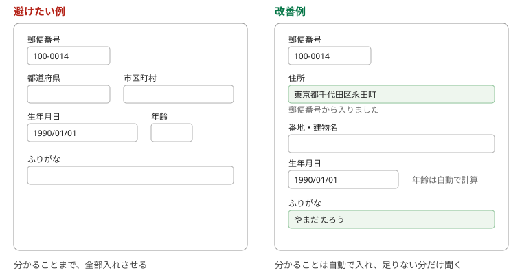
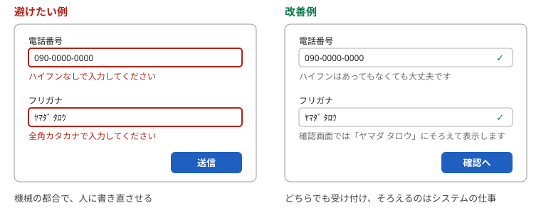
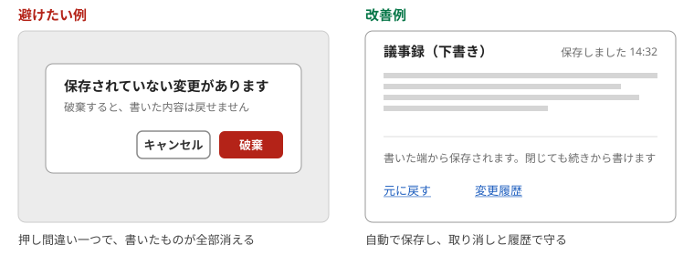
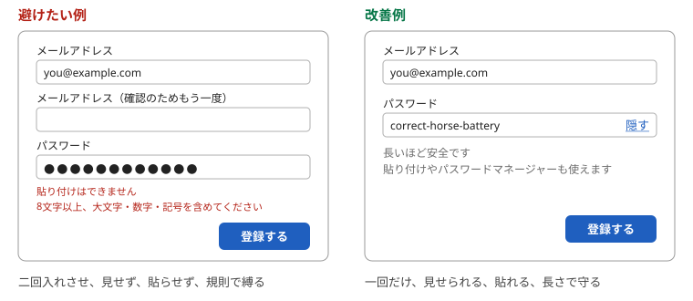

# 第8章　操作させない・失わせない — 聞かない、寛容に、自動保存、ログインと登録の癖

> 連載の入口 → [UI設計の基礎](README.md)

## ひとことで

利用者にさせる操作を、本当に必要な分だけにします。システムが分かることは聞きません。書き方の違いで突き返しません。書いたものは自動で守ります。そして、ログインや会員登録の画面で昔からの悪い癖を繰り返さないことです。

## なぜ

入力は、利用者にとっていちばん面倒な操作です。Apple の「[データの入力](https://developer.apple.com/jp/design/human-interface-guidelines/entering-data)」は、入力は方法を問わず退屈な作業だとしたうえで、利用者が入れる量を減らすために、取れる情報は先に集めておくよう勧めています。ソシオメディアの「[複雑性保存の法則](https://www.sociomedia.co.jp/9187)」も、複雑さは減らせず移動できるだけなので、できるだけ利用者側からシステム側へ移せ、と言います。

[第4章](04-feedback-errors.md)の「間違いを防ぐ」と[第7章](07-wayfinding.md)の「良い初期値」が、この章の土台です。この章では、それを「そもそも操作させない」まで進めます。

## 1. 聞かない

### システムが分かることは入力させない

Apple の指針が最初に挙げるのは、可能なときは常にシステムから情報を取る、という項目です。設定から分かること、許可をもらえば取れること（位置情報や予定表）を、人に打たせてはいけない、としています。ソシオメディアの「[ユーザーがとれる操作がひとつしかないなら自動化する](https://www.sociomedia.co.jp/9299)」は、許された入力が一種類しかないなら利用者がそれをする意味はなく、システムが代わりにやるべきだ、と言います。

郵便番号を入れたら住所は決まります。生年月日を入れたら年齢は決まります。決まるものを、もう一度聞かないことです。ソシオメディアの「[整合性を損なうような操作をユーザーに求めない](https://www.sociomedia.co.jp/9408)」は、生年月日と年齢を両方入力させる例を挙げて、食い違いが起きうる入力を求めるな、としています。

### 同じことを二度聞かない

一つの手続きの中で、前に入れた情報をもう一度打たせないことは、いまでは基準になっています。ウェブのアクセシビリティ基準 WCAG（ウェブコンテンツ・アクセシビリティ・ガイドライン）の最新版2.2にある達成基準3.3.7「冗長な入力項目」は、同じプロセスで再入力が必要な情報は自動入力されるか、利用者が選べるようにせよ、と定めています（[WCAG 2.2 日本語訳](https://waic.jp/translations/WCAG22/)）。例外は、再入力が必要不可欠な場合、セキュリティのために必要な場合、前に入れた情報がもう有効でない場合の三つです。[第2章](02-self-evident.md)の「記憶に頼らない」と同じ考え方です。

### 値を打たせるより、結果を選ばせる

Apple の指針は、できるだけ文字入力の代わりに選択肢を出すよう勧めています。一覧から選ぶほうが、キーボードがあっても速くて楽だからです。ソシオメディアの「[値を入力させるのではなく結果を選ばせる](https://www.sociomedia.co.jp/9464)」も同じで、設定の値ではなく、得られる結果を見せて選ばせよ、と言います。

| 避けたい例 | 改善例 |
| --- | --- |
| 郵便番号のあとに、都道府県と市区町村を手で入れさせる | 郵便番号から住所を埋め、番地だけ聞く |
| 生年月日と年齢を両方入れさせる | 生年月日だけ聞き、年齢は計算する |
| 申し込みの最後で、最初に入れた氏名をもう一度打たせる | 入れた値を表示し、直すときだけ編集できるようにする |
| 「画質: 1080p / 720p / 480p」と値で選ばせる | 「きれい（通信量が多い） / ふつう / 軽い」と結果で選ばせる |

## 2. 寛容に受け付ける

### 形式や文字種で突き返さない

電話番号のハイフン、カタカナの全角と半角、数字の全角と半角。こうした書き方の違いで入力を突き返すのは、機械の都合を人に押しつけることです。デジタル庁デザインシステムの「[インプットテキスト: 使い方](https://design.digital.go.jp/components/input-text/usage/)」は「原則として、入力できる文字種を限定しないようにします」と定めています。どうしても限定が要るときは、送信時に自動変換して確認画面で結果を見せ、利用者が承認か修正をできるようにせよ、としています。

NN/g の「[Preventing User Errors: Avoiding Unconscious Slips](https://www.nngroup.com/articles/slips/)」も、寛容な形式（Forgiving Formatting）を勧めています。利用者には自然な書き方で打たせ、括弧やハイフンを取り除くのは裏側の仕事にする、という考え方です。打ちながら形式をそろえて見せる方法も挙げています。

### 入力の条件は、エラーの前に書く

どうしても条件があるなら、入れる前に分かるように書きます。デジタル庁の同じページは、サポートテキストがなく、エラーが出て初めて入力条件が分かる形を悪い例としています。NN/g の「[Website Forms Usability: Top 10 Recommendations](https://www.nngroup.com/articles/web-form-design/)」も、形式の条件は正確に書くこと、リセットや消去のボタンは置かないこと、間違った入力は消さずに残すことを挙げています。

| 避けたい例 | 改善例 |
| --- | --- |
| 「090-0000-0000」を「ハイフンなしで入力してください」と突き返す | どちらでも受け付け、保存時にそろえる |
| 半角カナを「全角で入力してください」と突き返す | 受け付けて変換し、確認画面でそろえた結果を見せる |
| 条件を書かず、送信して初めて「8文字以上」と分かる | 欄の下に「8文字以上」とあらかじめ書く |
| フォームに「リセット」ボタンがある | 置かない。押し間違いで全部消える |

## 3. 失わせない

### 入力したものは利用者のもの

ソシオメディアの「[ユーザーが入力したものはユーザーのもの](https://www.sociomedia.co.jp/9398)」は、利用者が入力した値や設定は基本的にすべて保存されるべきだ、と言います。書いている途中で画面を閉じても、通信が切れても、戻ってきたら続きから書けるようにします。これが今の標準です。文書やメモの道具の多くは、保存ボタンを押さなくても書いた端から保存されます。

自動保存にするなら、[第4章](04-feedback-errors.md)の取り消しとセットにします。勝手に保存されるぶん、勝手に消えたり上書きされたりする不安が出るからです。NN/g の「[Preventing User Errors: Avoiding Conscious Mistakes](https://www.nngroup.com/articles/user-mistakes/)」は、直前の操作を取り消せることが利用者の安心と、新しい機能を試す勇気につながる、と書いています。Apple の「[取り消し/やり直し](https://developer.apple.com/jp/design/human-interface-guidelines/undo-and-redo)」にも、取り消しの作法があります。

### 保存ボタンにするなら、消さない

保存ボタンを残す場合も、入力は守ります。送信に失敗しても入力を消さない（[第4章](04-feedback-errors.md)）、途中で離れても下書きが残る、閉じる前に「保存していない」と知らせる、の三つです。[第1章](01-consistency.md)で見たとおり、大事なのは自動保存か保存ボタンかをサービスの中で一つに決めることです。設定のスイッチのように、部品の約束として切り替えた瞬間に効くものは別です（[第3章](03-labels-switches.md)）。

| 避けたい例 | 改善例 |
| --- | --- |
| 長文を書いている途中で通信が切れ、全部消える | 書いた端から下書きを保存し、戻ったら続きから |
| 「破棄しますか？」の「破棄」を押し間違えて消える | 自動保存にして、消すほうを取り消せるようにする |
| 自動保存だが、前の内容に戻せない | 「元に戻す」と変更履歴を付ける |
| 画面によって自動保存だったり保存ボタンだったりする | サービスの中で一つに決める |

## 4. ログインと登録の悪い癖

ログイン、会員登録、パスワードの設定の画面には、昔の作法が癖として残っています。いまの基準は、米国国立標準技術研究所（NIST）の「[SP 800-63B 第4版](https://pages.nist.gov/800-63-4/sp800-63b.html)」、Google の「[ログイン フォームのベスト プラクティス](https://web.dev/articles/sign-in-form-best-practices?hl=ja)」、英国政府の「[Passwords](https://design-system.service.gov.uk/patterns/passwords/)」です。三つはほぼ同じことを言っています。貼り付けとパスワードマネージャーについては、WCAG 2.2 の達成基準3.3.8「[アクセシブルな認証（最低限）](https://waic.jp/translations/WCAG22/)」も同じ立場です。この基準そのものは、パスワードを記憶させるような認知機能のテストを認証に求めない、という内容です。

### パスワードを隠したままにしない

隠すこと自体は、Apple の指針も勧める作法です。問題は、利用者が見たいときに見られないことです。NIST は、入力中のパスワードを点や星印ではなく表示する選択肢を提供すべきだとしています。web.dev も「パスワードを表示」の切り替えを付けるべきだという立場です。NN/g は「[Stop Password Masking](https://www.nngroup.com/articles/stop-password-masking/)」で、隠したままでは打ち間違いに気づけず、特にスマホで深刻だと指摘しました。

### メールアドレスを二回入れさせない

web.dev は、メールアドレスやパスワードを2回入力させるサイトについて、一部の利用者のエラーは減るかもしれないが、すべての利用者に余分な作業が生まれ、離脱が増える、と書いています。ブラウザが自動入力するなら、2回聞く意味はありません。確認は、入れた値を見せて直せるようにすれば足ります。これは WCAG 2.2 の「冗長な入力項目」の考え方とも同じです。

### 貼り付けを禁止しない

NIST は、パスワードマネージャーと自動入力を許さなければならず、貼り付けも許すべきだ、としています。パスワードマネージャーを使う人のほうが強いパスワードを選ぶからです。WCAG 2.2 の「アクセシブルな認証」も、パスワードマネージャーによる入力の支援とコピー＆ペーストを、記憶の負担を減らす仕組みとして挙げています。英国政府の指針も「利用者にパスワードを貼り付けさせる」を最初の三つの項目に入れています。

### 複雑さのルールと定期変更を求めない

NIST は、大文字・数字・記号の組み合わせを強制してはならず、定期的な変更も求めてはならない、と定めています。漏えいの証拠があるときだけ変更を強制します。英国政府の指針も、毎月の変更を求めると、忘れる、前のパスワードの小さな変形を選ぶ、安全でない場所にメモする、と書いています。代わりに、長さの下限を設け、上限は設けず、よくあるパスワードを拒否します。

| 避けたい例 | 改善例 |
| --- | --- |
| パスワードが点のままで、見る手段がない | 「表示」「隠す」の切り替えを付ける |
| 「メールアドレス（確認のためもう一度）」 | 一回だけ聞き、入れた値を見せて直せるようにする |
| パスワード欄に貼り付けできない | 貼り付けとパスワードマネージャーを許す |
| 「8文字以上、大文字・数字・記号を含めてください」 | 長さの下限だけ決め、よくあるパスワードを拒否する |
| 90日ごとにパスワードの変更を求める | 求めない。漏えいの疑いがあるときだけ変更させる |
| 失敗時に「パスワードが違います」と、どちらが違うかを明かす | 利用者名とパスワードのどちらが違うかは明かさない |

## やってみる

自分のサービスの入力欄を、一つずつ「これは利用者にしか分からないことか？」と問います。システムが分かること、前に聞いたこと、書き方の違い、で突き返している欄が、直す場所です。ログインと登録の画面は、上の表の六つをそのまま当ててください。

## 出典

- Apple「Human Interface Guidelines」 — [データの入力](https://developer.apple.com/jp/design/human-interface-guidelines/entering-data)、[取り消し/やり直し](https://developer.apple.com/jp/design/human-interface-guidelines/undo-and-redo)
- デジタル庁デザインシステム「[インプットテキスト: 使い方](https://design.digital.go.jp/components/input-text/usage/)」 — 入力値の文字種を限定しない
- WAIC「[WCAG 2.2（日本語訳）](https://waic.jp/translations/WCAG22/)」 — 達成基準3.3.7 冗長な入力項目、3.3.8 アクセシブルな認証（最低限）
- NIST「[SP 800-63B 第4版 Digital Identity Guidelines: Authentication and Authenticator Management](https://pages.nist.gov/800-63-4/sp800-63b.html)」 — パスワードの表示、貼り付け、構成ルール、定期変更
- web.dev「[ログイン フォームのベスト プラクティス](https://web.dev/articles/sign-in-form-best-practices?hl=ja)」 — 入力を重複させない、表示の切り替え
- GOV.UK Design System「[Passwords](https://design-system.service.gov.uk/patterns/passwords/)」 — 貼り付け、長さ、定期変更を求めない、失敗の理由を明かさない
- NN/g「[Preventing User Errors: Avoiding Unconscious Slips](https://www.nngroup.com/articles/slips/)」 — 寛容な形式
- NN/g「[Preventing User Errors: Avoiding Conscious Mistakes](https://www.nngroup.com/articles/user-mistakes/)」 — 取り消し
- NN/g「[Website Forms Usability: Top 10 Recommendations](https://www.nngroup.com/articles/web-form-design/)」 — 条件の明示、リセットボタンを置かない、入力を残す
- NN/g「[Stop Password Masking](https://www.nngroup.com/articles/stop-password-masking/)」 — 隠したままの害
- ソシオメディア「ヒューマンインターフェース ガイドライン」 — [ユーザーがとれる操作がひとつしかないなら自動化する](https://www.sociomedia.co.jp/9299)、[整合性を損なうような操作をユーザーに求めない](https://www.sociomedia.co.jp/9408)、[値を入力させるのではなく結果を選ばせる](https://www.sociomedia.co.jp/9464)、[複雑性保存の法則](https://www.sociomedia.co.jp/9187)、[ユーザーが入力したものはユーザーのもの](https://www.sociomedia.co.jp/9398)

---

次の章 → [AI に画面を作らせるときの見方](09-ai-review.md)
